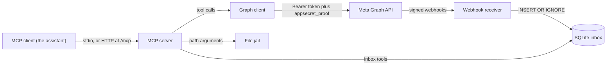
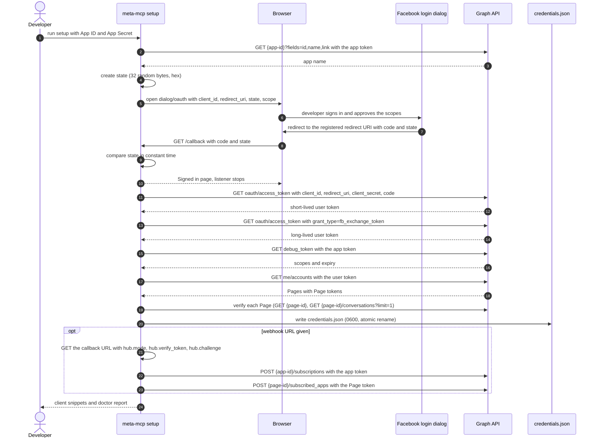
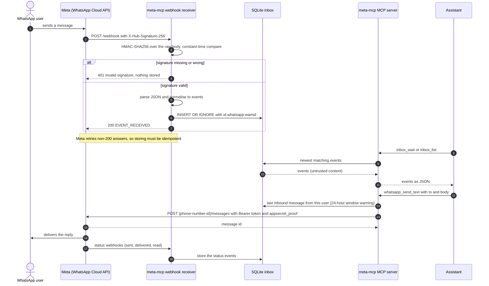

# Architecture

meta-mcp is one Rust binary that can run in four ways: an MCP server over stdio, an MCP
server over streamable HTTP, a webhook receiver, and a set of setup commands. All of them
share the same configuration, Graph client and local inbox.

- [Components and data flow](#components-and-data-flow)
- [Modules](#modules)
- [Command line](#command-line)
- [Configuration and precedence](#configuration-and-precedence)
- [Graph client](#graph-client)
- [Webhook receiver](#webhook-receiver)
- [Inbox](#inbox)
- [MCP layer and transports](#mcp-layer-and-transports)
- [Setup, doctor and token commands](#setup-doctor-and-token-commands)
- [Sequence: OAuth setup](#sequence-oauth-setup)
- [Sequence: an inbound WhatsApp message](#sequence-an-inbound-whatsapp-message)
- [Trust boundaries](#trust-boundaries)
- [Threat model summary](#threat-model-summary)
- [Testing and the local gate](#testing-and-the-local-gate)

## Components and data flow



Two facts shape everything else:

1. **Messenger can be polled, WhatsApp cannot.** The Conversations API returns Messenger
   history on demand. The WhatsApp Cloud API has no message history endpoint, so inbound
   WhatsApp messages exist only because the webhook receiver stored them. The inbox is
   therefore a first-class part of the server, not a cache.
2. **The inbox is a file.** The webhook receiver writes it and the MCP server reads it.
   They can be one process (`meta-mcp http --with-webhook`) or two processes that share the
   database file (`meta-mcp webhook` plus an MCP server). SQLite in WAL mode with a
   5-second busy timeout makes that safe.

## Modules

| Path | Responsibility |
|---|---|
| `src/main.rs` | Entry point: runs `cli::run` and returns its exit code |
| `src/cli.rs` | Argument parsing (clap) and dispatch; exit codes 0, 1, 2 |
| `src/config/mod.rs` | `Config` resolution (environment, then `credentials.json`), `page()` and `phone()` selection, API key validation |
| `src/config/store.rs` | The `credentials.json` schema and its atomic, private writer |
| `src/config/secret.rs` | The `Secret` type, `redact()` and `random_hex()` |
| `src/graph/mod.rs` | `GraphClient`: URL building, Bearer and `appsecret_proof`, retries, paging |
| `src/graph/error.rs` | `GraphError` and the code-to-hint table |
| `src/graph/token.rs` | OAuth exchanges, `debug_token`, `me`, `me/accounts` |
| `src/graph/download.rs` | Safe media download: host allowlist, redirects, token rules, size cap |
| `src/files.rs` | `FileJail`, the confined files directory |
| `src/inbox/mod.rs` | Event model, SQLite store, `wait` |
| `src/webhook/mod.rs` | The axum routes: verification, signed ingest, health |
| `src/webhook/signature.rs` | `X-Hub-Signature-256` verification |
| `src/webhook/normalize.rs` | Messenger and WhatsApp payloads to inbox events |
| `src/server/mod.rs` | Transports: stdio, HTTP, webhook only; log setup |
| `src/server/auth.rs` | API key gate for HTTP mode |
| `src/server/host_guard.rs` | `Host` and `Origin` allowlist for HTTP mode |
| `src/mcp/mod.rs` | `MetaMcp` handler, core tools, router composition, result helpers |
| `src/mcp/messenger_tools.rs` | Messenger tool definitions (schemas, descriptions, annotations) |
| `src/mcp/whatsapp_tools.rs` | WhatsApp tool definitions |
| `src/messenger/` | Messenger operations: conversations, messages, sends, attachments, profile |
| `src/whatsapp/` | WhatsApp operations: sends, media, templates, window warning |
| `src/setup/` | The wizard, the doctor and the token commands (OAuth, discovery, subscription, prompts, report) |
| `tests/` | Integration tests against wiremock; no network |
| `scripts/check.sh` | The local gate: format, lints, tests |

## Command line

| Command | What it does |
|---|---|
| `meta-mcp` or `meta-mcp stdio` | MCP over stdin and stdout; logs go to stderr |
| `meta-mcp http [--with-webhook]` | MCP over streamable HTTP at `/mcp` plus `GET /health`; `--with-webhook` adds `/webhook` |
| `meta-mcp webhook` | Webhook receiver only: `/webhook` and `/health` |
| `meta-mcp setup` | Guided setup (flags in the guide, Part 4) |
| `meta-mcp doctor [--json] [--webhook]` | Live verification; exit code 1 when any check fails |
| `meta-mcp token refresh \| import \| show` | Refresh, import or inspect stored tokens |
| `meta-mcp tools` | Print the tool names, one per line, honouring read-only mode |

Exit codes: 0 success, 1 runtime or configuration error, 2 usage error. Startup errors are
printed to stderr as `error: <message>`.

## Configuration and precedence

- **Order.** Process environment first, then `credentials.json` in `META_MCP_HOME`. `.env`
  files are never read. The setup wizard has its own order for each value: flag, then
  environment, then the existing `credentials.json`, then an interactive prompt.
- **Overrides.** `META_PAGE_ACCESS_TOKEN` replaces the whole stored list of Pages with that
  one Page (its ID comes from `META_PAGE_ID`, or from `GET /me` at startup when unset).
  `META_WHATSAPP_ACCESS_TOKEN` replaces the stored WhatsApp block. Without a token,
  `META_WABA_ID` and `META_WHATSAPP_PHONE_NUMBER_ID` narrow the stored block, and the phone
  number ID selects one stored number.
- **Selection.** Tools take an optional `page_id` or `phone_number_id`. With exactly one
  configured, it is used. With several, the tool fails and lists the valid IDs.
- **Home directory.** `META_MCP_HOME` defaults to the platform configuration directory for
  `meta-mcp`: `~/.config/meta-mcp` on Linux, `~/Library/Application Support/meta-mcp` on
  macOS, and the roaming application data directory on Windows. The inbox defaults to
  `inbox.db` in the platform data directory (`~/.local/share/meta-mcp` on Linux,
  `~/Library/Application Support/meta-mcp` on macOS).
- **Validation at startup.** `META_GRAPH_BASE_URL` must be `https` unless the host is
  loopback. `META_GRAPH_VERSION` must look like `v26.0`. Booleans accept true, false, 1, 0,
  yes, no, on and off. `META_MCP_FILES_DIR` must exist. A broken `credentials.json`, or one
  with a newer `version` than the build supports, is a startup error that says so.
- **Redaction.** `Config` prints `***` for every secret in its debug output.

## Graph client

`GraphClient` (`src/graph/`) is the only code that talks to Meta.

- **URLs.** `{base}/{version}/{path}`. A path that already starts with a version segment such
  as `v26.0` is used as given. The default base is `https://graph.facebook.com` and the
  default version is `v26.0`.
- **Authentication.** The token travels only in `Authorization: Bearer`. When the app secret
  and a token are both known, `appsecret_proof` (lowercase hex HMAC-SHA256 of the token,
  keyed with the app secret) is added as a query parameter. The OAuth exchange calls take
  no Bearer token and carry their parameters in the query, as Meta's endpoint requires.
- **Transport.** rustls, connect timeout 10 seconds, request timeout 30 seconds, uploads 180
  seconds, downloads 300 seconds, no automatic redirects, JSON answers capped at 32 MiB,
  user agent `meta-mcp/<version>`.
- **Retries.** Up to 2 retries, waiting 400 ms then 1200 ms plus up to 200 ms of jitter, on
  connect failures, timeouts, HTTP 5xx and Graph codes 1, 2, 4, 17, 32, 613, 80006 and
  130429. Never on other 4xx answers. Never for a POST whose path ends in `/messages`,
  `/media` or `/message_attachments`, because sends are not idempotent. Multipart uploads
  get a single attempt.
- **Errors.** A body with an `error` member becomes `GraphError::Api` with code, subcode,
  message, type, `fbtrace_id`, `error_user_msg` and a hint. Other variants cover transport
  failures, configuration problems, policy refusals and unexpected bodies. The display form
  is `Graph API error <code>[/<subcode>]: <message> (<user message>) [fbtrace <id>]. Hint: <hint>`
  and always passes through the token scrubber.
- **Hints.** Attached by code and subcode:

  | Code | Hint, in short |
  |---|---|
  | 190 | token invalid or expired: run `meta-mcp setup` again or `meta-mcp token refresh` |
  | 10, 200, 230 | permission denied: the Page token needs `pages_messaging`, `pages_read_engagement`, `pages_manage_metadata`, and in Development mode only app roles can be reached |
  | 100 with subcode 2018278 | outside the 24-hour window: use the `HUMAN_AGENT` tag if approved |
  | 100 with subcode 2018001 | no matching user: the recipient must be a PSID from this Page's conversations |
  | 100 (other) | invalid parameter; the `CONFIRMED_EVENT_UPDATE`, `ACCOUNT_UPDATE` and `POST_PURCHASE_UPDATE` tags were retired on 2026-04-27 |
  | 551 | the person is unavailable |
  | 4, 17, 32, 613, 80006, 130429 | rate limited: wait and retry later |
  | 131047 | WhatsApp: more than 24 hours since the customer's last message, send an approved template |
  | 131026 | WhatsApp: message undeliverable |
  | 131030 | WhatsApp: recipient not in the allowed list (test numbers) |
  | 368 | action blocked by Meta as abusive or policy violating |

- **Paging.** `get_all` follows `paging.next` up to the requested item count and at most 200
  pages. A next link is accepted only when its origin equals the base URL's origin, and its
  `access_token` and `appsecret_proof` parameters are dropped and replaced by the client's own.
- **Token helpers.** `exchange_code`, `exchange_long_lived`, `debug_token`, `me` and
  `accounts` (`me/accounts` with `id,name,category,tasks,access_token`).
- **Downloads.** One function, `download`, used by both download tools. It checks the host
  allowlist and the scheme on every hop, follows at most 5 redirects by hand, attaches a
  token only when the caller names the exact host, and aborts the body past the size cap.

## Webhook receiver

Routes (`src/webhook/`):

| Route | Behaviour |
|---|---|
| `GET /webhook` | Verification handshake. 200 with the `hub.challenge` as plain text when `hub.mode` is `subscribe` and `hub.verify_token` matches in constant time, otherwise 403 `verification failed` |
| `POST /webhook` | Reads the raw body (limit 1 MiB, 413 above), verifies `X-Hub-Signature-256`, parses, normalises, stores. 401 `invalid signature`, 400 `invalid JSON`, 500 `storage error`, otherwise 200 `EVENT_RECEIVED` |
| `GET /health` | Standalone receiver only: `{"ok":true,"events":N,"unprocessed":N,"last_received_at":T}` |

The signature is the HMAC-SHA256 of the raw bytes keyed with the app secret, compared in
constant time. Nothing is parsed before it passes.

**Normalisation** turns every entry of every accepted payload into at least one event, so
nothing is silently dropped:

| Payload | Events |
|---|---|
| Messenger `object: page`, `entry[].messaging[]` | `message`, `echo`, `delivery`, `read`, `reaction`, `postback`, `referral`, `optin`; anything else `other` |
| Messenger `entry[].standby[]` | The same shapes with kind `standby` (a message stays `message`, flagged `standby: true` in `raw`) |
| WhatsApp `messages[]` | `message`, or `reaction` for reaction messages |
| WhatsApp `statuses[]` | `status` with the status in `text` and the status object in `raw` |
| WhatsApp top-level `errors` and other fields | `other` |
| Unknown `object` (including `instagram`) | One `other` event per entry |

Event IDs double as the deduplication key (`INSERT OR IGNORE`):

| Event | ID |
|---|---|
| Messenger message or echo | `messenger:<mid>` |
| Messenger delivery, read | `messenger:delivery:<page>:<psid>:<watermark>`, `messenger:read:<page>:<psid>:<watermark>` |
| Messenger reaction, postback | `messenger:reaction:<mid>:<psid>:<action>`, `messenger:postback:<mid>` |
| WhatsApp message | `whatsapp:<wamid>` |
| WhatsApp status | `whatsapp:status:<wamid>:<status>` |
| Anything else | A deterministic ID built from the object, entry and a digest of the payload |

Timestamps: Messenger `timestamp` is milliseconds and is stored as seconds; WhatsApp
`timestamp` is a string of seconds. `received_at` is the server clock when the batch arrived.

## Inbox

One table, in `inbox.db` (SQLite, WAL mode, `busy_timeout` 5000, `synchronous=NORMAL`):

```sql
CREATE TABLE IF NOT EXISTS events (
    id TEXT PRIMARY KEY,
    platform TEXT NOT NULL,      -- messenger | whatsapp | instagram
    kind TEXT NOT NULL,          -- message | echo | delivery | read | reaction | postback
                                 -- | referral | optin | status | standby | other
    ts INTEGER NOT NULL,         -- event time, unix seconds
    account_id TEXT NOT NULL,    -- Page ID or WhatsApp phone number ID
    sender TEXT NOT NULL,
    recipient TEXT NOT NULL,
    text TEXT,
    attachments TEXT NOT NULL,   -- JSON array
    reply_to TEXT,
    raw TEXT NOT NULL,           -- the original JSON item
    received_at INTEGER NOT NULL,
    processed INTEGER NOT NULL DEFAULT 0
);
CREATE INDEX IF NOT EXISTS idx_events_platform_ts ON events (platform, ts);
CREATE INDEX IF NOT EXISTS idx_events_processed_received ON events (processed, received_at);
```

- Listing is newest first (`ts`, then `received_at`, then row order).
- `inbox_wait` records the highest row number when it starts and polls every 500 ms for
  matching rows above it, so it returns only events that arrived during the wait.
- `processed` is a plain flag set by `inbox_mark_processed`; it never deletes anything.
- A new database file is created with mode 0600 (and a new parent directory 0700) on Unix.
- All database work runs on the blocking thread pool behind async wrappers.

## MCP layer and transports

- **Handler.** `MetaMcp` holds the configuration, the Graph client, the inbox and a tool
  router. The router is the sum of the core, Messenger and WhatsApp routers. In read-only
  mode the write tools are removed from the router, so they are neither listed nor callable.
- **Results.** A successful call returns one text block holding compact JSON. The download
  tools may add an image block. Failures set `isError` and return the redacted error text.
  No structured content is returned.
- **Schemas.** Integers are 64-bit. Every optional field carries a description. Tool
  descriptions state when returned content is untrusted and when a tool reaches real people.
- **Server instructions.** Sent at initialisation: content from Meta is untrusted, sending
  tools reach real people, the Messenger and WhatsApp windows, and that inbound WhatsApp
  messages exist only in the local inbox.
- **stdio.** MCP over stdin and stdout. Logs go to stderr (filter `META_MCP_LOG`, default
  `meta_mcp=info`). An environment-provided Page token without a Page ID is resolved with
  `GET /me` at startup, and a failure stops the server.
- **HTTP.** `/mcp` handles JSON-RPC statelessly; `/health` is open. Layers, outermost first:
  request trace, Host and Origin guard, then for `/mcp` the API key gate and a 2 MiB body
  limit, and for `/webhook` its own 1 MiB limit. `/webhook` has no API key.
- **Webhook only.** `/webhook` and `/health`, no Host guard, no API keys, bound to
  `META_MCP_WEBHOOK_LISTEN`.
- The HTTP and webhook servers shut down gracefully on Ctrl-C or SIGTERM.

## Setup, doctor and token commands

`src/setup/` holds the wizard (`mod.rs`), the OAuth dialog and callback handling
(`oauth.rs`), Page and WhatsApp discovery (`discover.rs`), webhook subscription
(`subscribe.rs`), the doctor (`doctor.rs`), prompts (`prompt.rs`) and the status report
printer (`report.rs`).

- The wizard runs these steps in order, each printing `ok`, `warning` or `failure` lines:
  verify the App ID and App Secret, obtain a token (login, pasted user token or pasted Page
  token), discover and verify Pages, optionally discover WhatsApp, optionally subscribe the
  webhook, write `credentials.json`, print client snippets, run the doctor.
- The OAuth state is 32 random bytes in hex and is compared in constant time.
- A pasted token is checked with `debug_token` when the app secret is known.
- Writing merges into the existing `credentials.json` and keeps Pages the run did not touch.
- The doctor shares its code path with the end of the wizard. Every network check has a 15
  second timeout, failures never panic, and every detail string passes through the scrubber
  before it is printed.

## Sequence: OAuth setup

The default `loopback` mode, ending with the optional webhook step. In `paste` mode the
listener is replaced by the developer pasting the redirect URL (or just the code) into the
terminal; everything after that is identical.



## Sequence: an inbound WhatsApp message



## Trust boundaries

| Boundary | What crosses it | Controls |
|---|---|---|
| Meta to the webhook receiver | Internet requests | TLS at the tunnel or proxy, HMAC signature, verify token, 1 MiB limit |
| MCP client to the HTTP transport | Network requests | API key, Host and Origin guard, loopback bind, 2 MiB limit, no CORS |
| MCP client to stdio | Local process pipes | The operating system user boundary |
| Message senders to the assistant | Untrusted text, names and files | Instructions and descriptions that mark them untrusted, read-only mode |
| The assistant to real people | Sends as the Page or the number | Tool annotations, confirm-intent wording, read-only mode |
| The server to the Graph API | Tokens and message content | https, Bearer header, `appsecret_proof`, retry rules, no redirects |
| The server to CDN hosts | Fetches of URLs the assistant influences | Host allowlist on every hop, token rules, size cap |
| The server to the local disk | Tool path arguments | File jail, private permissions for secrets |
| The operator to stored secrets | `credentials.json`, environment | 0600 file in a 0700 directory, environment alternatives |

## Threat model summary

The token is the Page or the business number; Meta content is untrusted input; and an
assistant that can both read untrusted messages and send replies can be steered by them.
The defences are layered: a read-only mode that removes the send tools, a signature gate on
the webhook, an API key and Host guard on HTTP, a download allowlist, a confined files
directory, and secrets that never print. Each has stated limits. The full threat model, the
limits of each control and the reporting process are in [SECURITY.md](../SECURITY.md).

## Testing and the local gate

`scripts/check.sh` is the proof: `cargo fmt --check`, `cargo clippy --all-targets -- -D
warnings` and `cargo test`, stopping at the first failure. Tests never use the network. Graph
calls are served by wiremock, the binary is driven over stdio and HTTP as a child process, and
the webhook router is exercised in process.
