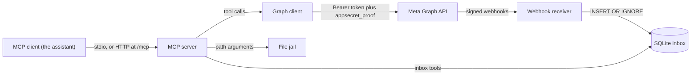
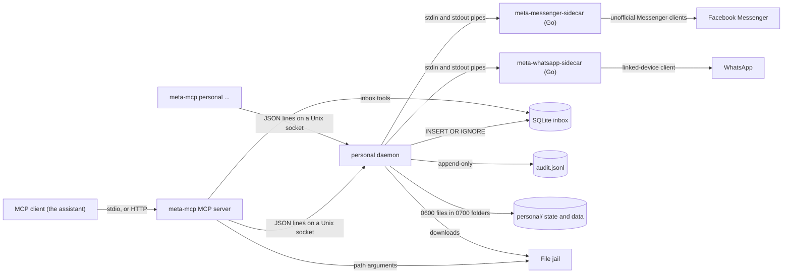
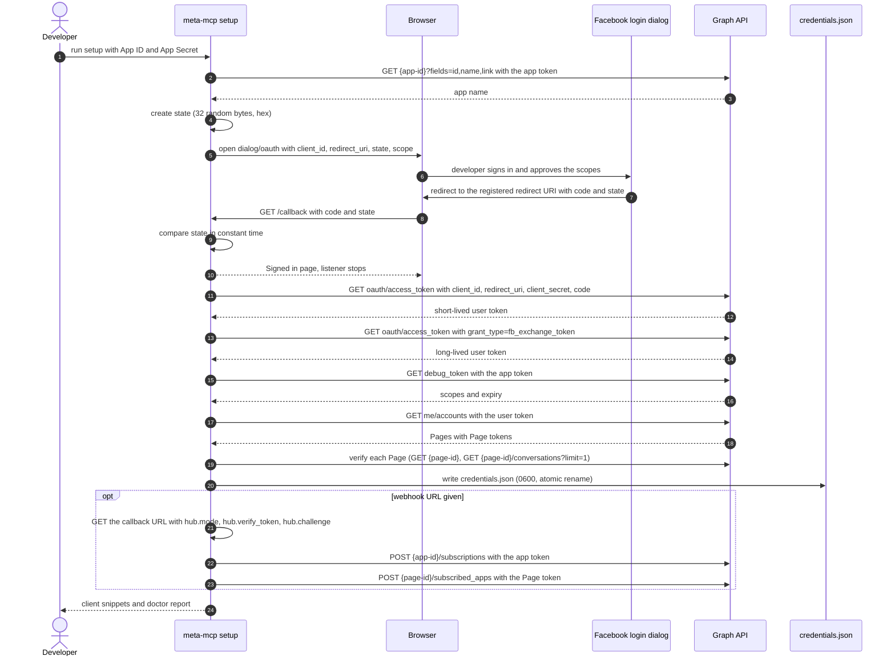
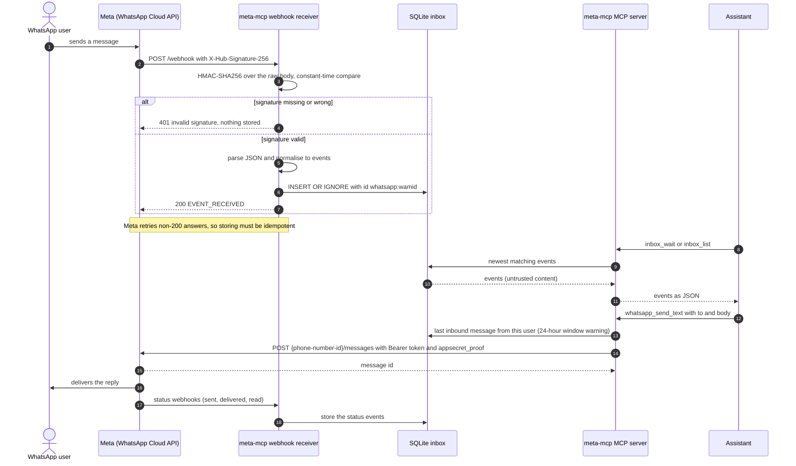
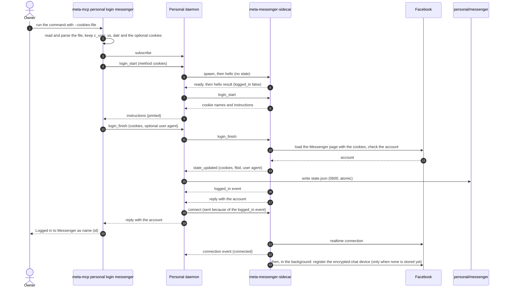
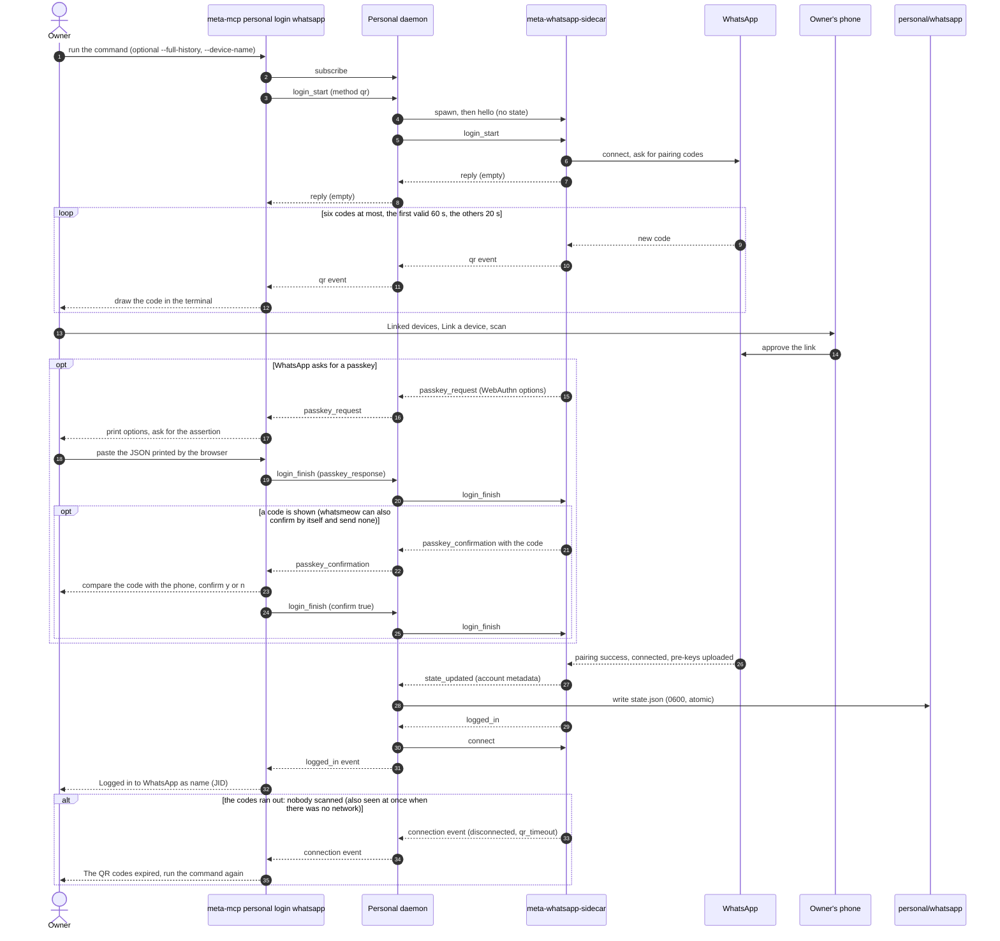
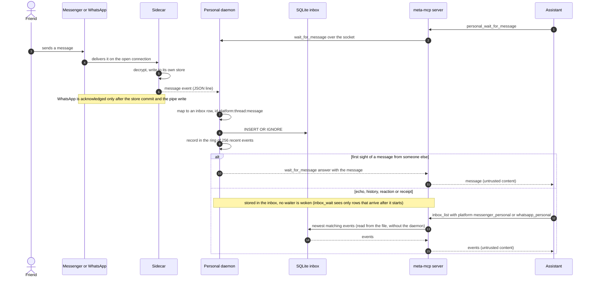
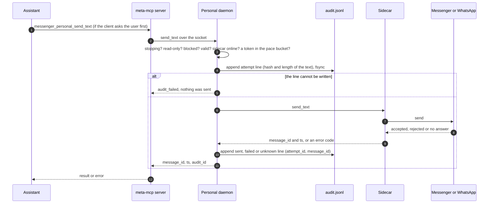

# Architecture

meta-mcp is one Rust binary that can run in four ways: an MCP server over stdio, an MCP
server over streamable HTTP, a webhook receiver, and a set of setup commands. All of them
share the same configuration, Graph client and local inbox.

A second mode, the **personal mode**, reaches your own Messenger and WhatsApp accounts, which the Graph
API cannot. It adds a long-lived daemon (`meta-mcp personal daemon`), two Go sidecar programs that the
daemon owns, a command group (`meta-mcp personal ...`) and 19 more tools on the same MCP server (served over
stdio; `meta-mcp http` leaves them out unless `META_MCP_PERSONAL_HTTP=1`). Personal mode is compiled on Unix systems
only (`#[cfg(unix)]`); elsewhere the server has the 20 business tools. It is described in
[Personal mode](#personal-mode). The rest of this page, up to that section, is about the business mode.

- [Components and data flow](#components-and-data-flow)
- [Modules](#modules)
- [Command line](#command-line)
- [Configuration and precedence](#configuration-and-precedence)
- [Graph client](#graph-client)
- [Webhook receiver](#webhook-receiver)
- [Inbox](#inbox)
- [MCP layer and transports](#mcp-layer-and-transports)
- [Setup, doctor and token commands](#setup-doctor-and-token-commands)
- [Personal mode](#personal-mode)
- [Sequence: OAuth setup](#sequence-oauth-setup)
- [Sequence: an inbound WhatsApp message](#sequence-an-inbound-whatsapp-message)
- [Sequence: a Messenger login](#sequence-a-messenger-login)
- [Sequence: a WhatsApp link](#sequence-a-whatsapp-link)
- [Sequence: an inbound personal message](#sequence-an-inbound-personal-message)
- [Sequence: a personal send](#sequence-a-personal-send)
- [Trust boundaries](#trust-boundaries)
- [Threat model summary](#threat-model-summary)
- [Testing and the local gate](#testing-and-the-local-gate)

## Components and data flow



Two facts shape everything else:

1. **Messenger can be polled, WhatsApp cannot.** The Conversations API returns Messenger
   history on demand. The WhatsApp Cloud API has no message history endpoint, so inbound
   WhatsApp messages exist only because the webhook receiver stored them. The inbox is
   therefore a first-class part of the server, not a cache.
2. **The inbox is a file.** The webhook receiver writes it and the MCP server reads it.
   They can be one process (`meta-mcp http --with-webhook`) or two processes that share the
   database file (`meta-mcp webhook` plus an MCP server). SQLite in WAL mode with a
   5-second busy timeout makes that safe. In personal mode the personal daemon is a third writer
   of the same file.

## Modules

| Path | Responsibility |
|---|---|
| `src/main.rs` | Entry point: runs `cli::run` and returns its exit code |
| `src/cli.rs` | Argument parsing (clap) and dispatch; exit codes 0, 1, 2 |
| `src/config/mod.rs` | `Config` resolution (environment, then `credentials.json`), `page()` and `phone()` selection, API key validation |
| `src/config/store.rs` | The `credentials.json` schema and its atomic, private writer |
| `src/config/secret.rs` | The `Secret` type, `redact()` and `random_hex()` |
| `src/graph/mod.rs` | `GraphClient`: URL building, Bearer and `appsecret_proof`, retries, paging |
| `src/graph/error.rs` | `GraphError` and the code-to-hint table |
| `src/graph/token.rs` | OAuth exchanges, `debug_token`, `me`, `me/accounts` |
| `src/graph/download.rs` | Safe media download: host allowlist, the Graph host refused, redirects, token rules, size cap |
| `src/files.rs` | `FileJail`, the confined files directory, and its `inbound/` folder for downloads |
| `src/inbox/mod.rs` | Event model, SQLite store, `wait` |
| `src/webhook/mod.rs` | The axum routes: verification, signed ingest, health |
| `src/webhook/signature.rs` | `X-Hub-Signature-256` verification |
| `src/webhook/normalize.rs` | Messenger and WhatsApp payloads to inbox events |
| `src/server/mod.rs` | Transports: stdio, HTTP, webhook only; log setup |
| `src/server/auth.rs` | API key gate for HTTP mode |
| `src/server/host_guard.rs` | `Host` and `Origin` allowlist for HTTP mode |
| `src/mcp/mod.rs` | `MetaMcp` handler, core tools, router composition, result helpers |
| `src/mcp/messenger_tools.rs` | Messenger tool definitions (schemas, descriptions, annotations) |
| `src/mcp/whatsapp_tools.rs` | WhatsApp tool definitions |
| `src/mcp/personal_tools.rs` | The 19 personal tool definitions (Unix only), and the lazily connected socket client they share |
| `src/messenger/` | Messenger operations: conversations, messages, sends, attachments, profile |
| `src/whatsapp/` | WhatsApp operations: sends, media, templates, window warning |
| `src/setup/` | The wizard, the doctor and the token commands (OAuth, discovery, subscription, prompts, report) |
| `src/personal/mod.rs` | `PersonalPlatform`, the default socket path, the `personal/` folder, the daemon's own uid (read from the peer credential of a socket pair). The whole `personal` module is `#[cfg(unix)]` |
| `src/personal/protocol.rs`, `link.rs` | The typed frames of the sidecar line protocol (version 1) and the line-framed request/reply link used for both the sidecar pipes and the daemon socket |
| `src/personal/sidecar.rs` | Locating, spawning (empty environment) and stopping a sidecar; the `hello` handshake |
| `src/personal/client.rs` | The socket client used by the tools and the commands; it checks that the daemon behind the socket runs as the same uid |
| `src/personal/state.rs`, `audit.rs`, `validate.rs` | The session state files and folders (modes, atomic writes), the append-only send audit log, and the input checks for writes |
| `src/personal/daemon.rs`, `src/personal/daemon/` | The daemon: socket (`listen.rs`), connections (`conn.rs`), the byte-capped event ring for subscribers (`hub.rs`), op dispatch (`ops.rs`), login and logout (`login.rs`), platform lifecycle, reconnects and the sidecar heartbeat (`platform.rs`), sidecar events (`events.rs`), inbox mapping (`inbox_map.rs`), the recent-messages ring (`ring.rs`), write pacing (`pace.rs`) and the write pipeline (`write.rs`) |
| `src/personal/cli.rs`, `src/personal/cli/` | The `meta-mcp personal` commands: login flows, cookie parsing, QR drawing, status, install |
| `sidecars/messenger/` | The Go Messenger sidecar (mautrix-meta messagix, whatsmeow for encrypted chats); `docs/SIDECAR-MESSENGER.md` |
| `sidecars/whatsapp/` | The Go WhatsApp sidecar (whatsmeow plus its own message store); `docs/SIDECAR-WHATSAPP.md` |
| `tests/` | Integration tests against wiremock and scripted fake sidecars; no network |
| `scripts/check.sh` | The local gate: format, lints, tests |
| `scripts/build-all.sh` | Builds `meta-mcp` and both sidecars into `dist/` |

## Command line

| Command | What it does |
|---|---|
| `meta-mcp` or `meta-mcp stdio` | MCP over stdin and stdout; logs go to stderr |
| `meta-mcp http [--with-webhook]` | MCP over streamable HTTP at `/mcp` plus `GET /health`; `--with-webhook` adds `/webhook`. The personal tools are registered only when `META_MCP_PERSONAL_HTTP=1` |
| `meta-mcp webhook` | Webhook receiver only: `/webhook` and `/health` |
| `meta-mcp setup` | Guided setup (flags in the guide, Part 4) |
| `meta-mcp doctor [--json] [--webhook]` | Live verification; exit code 1 when any check fails |
| `meta-mcp token refresh \| import \| show` | Refresh, import or inspect stored tokens |
| `meta-mcp tools` | Print the tool names of the stdio server, one per line, honouring read-only mode |
| `meta-mcp personal daemon [--socket PATH]` | The personal daemon (Personal mode below) |
| `meta-mcp personal login messenger [--cookies-file PATH] \| whatsapp [--pair-code PHONE]` | Log in through the daemon (cookies for Messenger, from a file or a hidden prompt; QR code or pair code for WhatsApp) |
| `meta-mcp personal status [--json]`, `logout PLATFORM`, `restart PLATFORM` | Show both accounts, log out (stop the sidecar, delete the session, empty the platform's data folder), restart a sidecar and clear a sending block |
| `meta-mcp personal install [--dry-run]`, `uninstall [--dry-run]` | Write and start, or remove, the systemd user units of the daemon. `install` creates the home and the inbox folder and refuses a configured files directory that does not exist |

Exit codes: 0 success, 1 runtime or configuration error, 2 usage error. Startup errors are
printed to stderr as `error: <message>`. The personal daemon exits 2 on a configuration error, and the
unit `personal install` writes does not restart it for that status (`RestartPreventExitStatus=2`). On a system
without personal mode, `meta-mcp personal ...` prints `personal mode needs a Unix system` and exits 2.

## Configuration and precedence

- **Order.** Process environment first, then `credentials.json` in `META_MCP_HOME`. `.env`
  files are never read. The setup wizard has its own order for each value: flag, then
  environment, then the existing `credentials.json`, then an interactive prompt.
- **Overrides.** `META_PAGE_ACCESS_TOKEN` replaces the whole stored list of Pages with that
  one Page (its ID comes from `META_PAGE_ID`, or from `GET /me` at startup when unset).
  `META_WHATSAPP_ACCESS_TOKEN` replaces the stored WhatsApp block. Without a token,
  `META_WABA_ID` and `META_WHATSAPP_PHONE_NUMBER_ID` narrow the stored block, and the phone
  number ID selects one stored number.
- **Selection.** Tools take an optional `page_id` or `phone_number_id`. With exactly one
  configured, it is used. With several, the tool fails and lists the valid IDs.
- **Home directory.** `META_MCP_HOME` defaults to the platform configuration directory for
  `meta-mcp`: `~/.config/meta-mcp` on Linux, `~/Library/Application Support/meta-mcp` on
  macOS, and the roaming application data directory on Windows. The inbox defaults to
  `inbox.db` in the platform data directory (`~/.local/share/meta-mcp` on Linux,
  `~/Library/Application Support/meta-mcp` on macOS).
- **Validation at startup.** `META_GRAPH_BASE_URL` must be `https` unless the host is
  loopback. `META_GRAPH_VERSION` must look like `v26.0`. Booleans accept true, false, 1, 0,
  yes, no, on and off. `META_MCP_FILES_DIR` must exist and, once symlinks are resolved, must not
  contain `META_MCP_HOME`, `credentials.json` or the inbox database; the error names the overlap.
  A broken `credentials.json`, or one with a newer `version` than the build supports, is a
  startup error that says so.
- **Personal mode.** `META_MCP_PERSONAL_SOCKET` (the daemon socket) and `META_MCP_SIDECAR_DIR` (where the
  sidecar binaries are) are read by the personal code only; `META_MCP_PERSONAL_BACKOFF_MS` tunes the daemon's
  reconnect delays and `META_MCP_PERSONAL_STABLE_MS` (default 120000) how long a connection must last before they
  start over; `META_MCP_PERSONAL_PING_MS` (30000) and `META_MCP_PERSONAL_PING_TIMEOUT_MS` (10000) set the sidecar
  heartbeat; `META_MCP_PERSONAL_SEND_INTERVAL_MS` (2000) and `META_MCP_PERSONAL_SEND_BURST` (3) set the pacing of new
  messages. `META_MCP_PERSONAL_HTTP=1` makes `meta-mcp http` register the personal tools. The daemon reads the rest
  of the configuration like any other command, and keeps its files in `<META_MCP_HOME>/personal/`.
- **Redaction.** `Config` prints `***` for every secret in its debug output.

## Graph client

`GraphClient` (`src/graph/`) is the only code that talks to Meta.

- **URLs.** `{base}/{version}/{path}`. A path that already starts with a version segment such
  as `v26.0` is used as given. The default base is `https://graph.facebook.com` and the
  default version is `v26.0`.
- **Authentication.** The token travels only in `Authorization: Bearer`. When the app secret
  and a token are both known, `appsecret_proof` (lowercase hex HMAC-SHA256 of the token,
  keyed with the app secret) is added as a query parameter. The OAuth exchange calls take
  no Bearer token and carry their parameters in the query, as Meta's endpoint requires.
- **Transport.** rustls, connect timeout 10 seconds, request timeout 30 seconds, uploads 180
  seconds, downloads 300 seconds, no automatic redirects, JSON answers capped at 32 MiB,
  user agent `meta-mcp/<version>`.
- **Retries.** Up to 2 retries, waiting 400 ms then 1200 ms plus up to 200 ms of jitter, on
  connect failures, timeouts, HTTP 5xx and Graph codes 1, 2, 4, 17, 32, 613, 80006 and
  130429. Never on other 4xx answers. Never for a POST whose path ends in `/messages`,
  `/media` or `/message_attachments`, because sends are not idempotent. Multipart uploads
  get a single attempt. `GraphClient::get_with_retry` lets a caller that paces its own requests
  turn the retries off: Messenger conversation reads do, spacing calls 500 ms apart per Page
  and repeating a transiently failed read once through the same spacing.
- **Errors.** A body with an `error` member becomes `GraphError::Api` with code, subcode,
  message, type, `fbtrace_id`, `error_user_msg` and a hint. Other variants cover transport
  failures, configuration problems, policy refusals and unexpected bodies. The display form
  is `Graph API error <code>[/<subcode>]: <message> (<user message>) [fbtrace <id>]. Hint: <hint>`
  and always passes through the token scrubber.
- **Hints.** Attached by code and subcode:

  | Code | Hint, in short |
  |---|---|
  | 190 | token invalid or expired: run `meta-mcp setup` again or `meta-mcp token refresh` |
  | 10, 200, 230 | permission denied: the Page token needs `pages_messaging`, `pages_read_engagement`, `pages_manage_metadata`, and in Development mode only app roles can be reached |
  | any code with subcode 2018278 or 2534022 | outside the 24-hour window: the person must message the Page first (the Messenger tools add that `HUMAN_AGENT` is only for a person replying by hand, never for generated replies) |
  | 200 with subcode 2018028 | the app is not approved yet: the Page can only message people with a role on the app |
  | 100 with subcode 2018001 | no matching user: the recipient must be a PSID from this Page's conversations |
  | 100 (other) | invalid parameter; the `CONFIRMED_EVENT_UPDATE`, `ACCOUNT_UPDATE` and `POST_PURCHASE_UPDATE` tags were retired on 2026-04-27 |
  | 551 | the person is unavailable |
  | 4, 17, 32, 613, 80006, 130429 | rate limited: wait and retry later |
  | 131047 | WhatsApp: more than 24 hours since the customer's last message, send an approved template |
  | 131026 | WhatsApp: message undeliverable |
  | 131030 | WhatsApp: recipient not in the allowed list (test numbers) |
  | 368 | action blocked by Meta as abusive or policy violating |

- **Paging.** `get_all` follows `paging.next` up to the requested item count and at most 200
  pages. A next link is accepted only when its origin equals the base URL's origin, and its
  `access_token` and `appsecret_proof` parameters are dropped and replaced by the client's own.
- **Token helpers.** `exchange_code`, `exchange_long_lived`, `debug_token`, `me` and
  `accounts` (`me/accounts` with `id,name,category,tasks,access_token`).
- **Downloads.** One function, `download`, used by both download tools. On every hop it refuses
  the Graph API host and checks the host allowlist (`*.fbcdn.net`, `*.fbsbx.com`,
  `*.whatsapp.net`, `lookaside.fbsbx.com`, plus operator hosts) and the scheme. It follows at
  most 5 redirects by hand, attaches a token only when the caller names the exact host and
  port, and aborts the body past the size cap. The callers decide which hosts may receive their
  token and where the bytes go: `inbound/messenger/` or `inbound/whatsapp/` in the files
  directory. The upload tools refuse files under `inbound/` unless `allow_inbound` is set.

## Webhook receiver

Routes (`src/webhook/`):

| Route | Behaviour |
|---|---|
| `GET /webhook` | Verification handshake. 200 with the `hub.challenge` as plain text when `hub.mode` is `subscribe` and `hub.verify_token` matches in constant time, otherwise 403 `verification failed` |
| `POST /webhook` | Reads the raw body (limit 1 MiB, 413 above), verifies `X-Hub-Signature-256`, parses, normalises, stores. 401 `invalid signature`, 400 `invalid JSON`, 500 `storage error`, otherwise 200 `EVENT_RECEIVED` |
| `GET /health` | Standalone receiver only: `{"ok":true,"events":N,"unprocessed":N,"last_received_at":T}` |

The signature is the HMAC-SHA256 of the raw bytes keyed with the app secret, compared in
constant time. Nothing is parsed before it passes.

**Normalisation** turns every entry of every accepted payload into at least one event, so
nothing is silently dropped:

| Payload | Events |
|---|---|
| Messenger `object: page`, `entry[].messaging[]` | `message`, `echo`, `delivery`, `read`, `reaction`, `postback`, `referral`, `optin`; anything else `other` |
| Messenger `entry[].standby[]` | The same shapes with kind `standby` (a message stays `message`, flagged `standby: true` in `raw`) |
| WhatsApp `messages[]` | `message`, or `reaction` for reaction messages |
| WhatsApp `statuses[]` | `status` with the status in `text` and the status object in `raw` |
| WhatsApp top-level `errors` and other fields | `other` |
| Unknown `object` (including `instagram`) | One `other` event per entry |

Event IDs double as the deduplication key (`INSERT OR IGNORE`):

| Event | ID |
|---|---|
| Messenger message or echo | `messenger:<mid>` |
| Messenger delivery, read | `messenger:delivery:<page>:<psid>:<watermark>`, `messenger:read:<page>:<psid>:<watermark>` |
| Messenger reaction, postback | `messenger:reaction:<mid>:<psid>:<action>`, `messenger:postback:<mid>` |
| WhatsApp message | `whatsapp:<wamid>` |
| WhatsApp status | `whatsapp:status:<wamid>:<status>`, plus `:<participant>` for a group status |
| Anything else | A deterministic ID built from the object, entry and a digest of the payload; for WhatsApp `other` and error events it also carries the time the batch arrived, so the same payload sent again later is stored again |

Timestamps: Messenger `timestamp` is milliseconds and is stored as seconds; WhatsApp
`timestamp` is a string of seconds. `received_at` is the server clock when the batch arrived.

## Inbox

One table, in `inbox.db` (SQLite, WAL mode, `busy_timeout` 5000, `synchronous=NORMAL`):

```sql
CREATE TABLE IF NOT EXISTS events (
    id TEXT PRIMARY KEY,
    platform TEXT NOT NULL,      -- messenger | whatsapp | instagram
                                 -- | messenger_personal | whatsapp_personal
    kind TEXT NOT NULL,          -- message | echo | delivery | read | reaction | postback
                                 -- | referral | optin | status | standby | other
    ts INTEGER NOT NULL,         -- event time, unix seconds
    account_id TEXT NOT NULL,    -- Page ID, WhatsApp phone number ID or personal account ID
    sender TEXT NOT NULL,
    recipient TEXT NOT NULL,
    text TEXT,
    attachments TEXT NOT NULL,   -- JSON array
    reply_to TEXT,
    raw TEXT NOT NULL,           -- the original JSON item
    received_at INTEGER NOT NULL,
    processed INTEGER NOT NULL DEFAULT 0
);
CREATE INDEX IF NOT EXISTS idx_events_platform_ts ON events (platform, ts);
CREATE INDEX IF NOT EXISTS idx_events_processed_received ON events (processed, received_at);
```

- Listing is newest first (`ts`, then `received_at`, then row order).
- The personal daemon writes its rows through the same code, with the platforms `messenger_personal` and
  `whatsapp_personal`. Their IDs (the deduplication key) are built from the thread as well as the message,
  because a WhatsApp message ID is unique within one chat only:

  | Event | ID |
  |---|---|
  | Message or echo (a message from your own account) | `<platform>:<thread_id>:<message_id>` |
  | Reaction | `<platform>:reaction:<thread_id>:<message_id>:<sender_id>:<ts>` |
  | Read or delivery receipt | `<platform>:read:<thread_id>:<sender_id>:<up_to_ts>`, `<platform>:delivered:<thread_id>:<sender_id>:<up_to_ts>` |

  `recipient` holds the thread ID, `sender` the author and `account_id` the logged-in account. `raw` holds the
  sidecar event; for a history row it holds the message and `"history": true`. A message or a reaction without
  an ID, and a receipt without a thread, are not stored.
- `inbox_wait` records the highest row number when it starts and polls every 500 ms for
  matching rows above it, so it returns only events that arrived during the wait.
- `processed` is a plain flag set by `inbox_mark_processed`; it never deletes anything.
- A new database file is created with mode 0600 (and a new parent directory 0700) on Unix.
- All database work runs on the blocking thread pool behind async wrappers.

## MCP layer and transports

- **Handler.** `MetaMcp` holds the configuration, the Graph client, the inbox and a tool
  router. The router is the sum of the core, Messenger, WhatsApp and personal routers (39 tools on Unix over stdio).
  The personal router is added for stdio, and for `meta-mcp http` only when `META_MCP_PERSONAL_HTTP=1`; without
  personal mode compiled in (non-Unix) it is absent, leaving 20 tools. In read-only mode the write tools (11
  business, 10 personal) are removed from the router, so they are neither listed nor callable.
- **Results.** A successful call returns one text block holding compact JSON. The download
  tools may add an image block. Failures set `isError` and return the redacted error text.
  No structured content is returned.
- **Schemas.** Integers are 64-bit. Every optional field carries a description. Tool
  descriptions state when returned content is untrusted and when a tool reaches real people.
- **Server instructions.** Sent at initialisation: content from Meta is untrusted, sending
  tools reach real people, the Messenger and WhatsApp windows (and that `HUMAN_AGENT` is for a
  person replying by hand, not for generated replies), and that inbound WhatsApp messages
  exist only in the local inbox, and that the personal tools act as the owner on the owner's own accounts, reach real
  people as the owner and are outside the platforms' terms, so sending needs confirmation.
- **stdio.** MCP over stdin and stdout. Logs go to stderr (filter `META_MCP_LOG`, default
  `meta_mcp=info`). An environment-provided Page token without a Page ID is resolved with
  `GET /me` at startup, and a failure stops the server.
- **HTTP.** `/mcp` handles JSON-RPC statelessly; `/health` is open. Layers, outermost first:
  request trace, Host and Origin guard, then for `/mcp` the API key gate and a 2 MiB body
  limit, and for `/webhook` its own 1 MiB limit. `/webhook` has no API key.
- **Webhook only.** `/webhook` and `/health`, no Host guard, no API keys, bound to
  `META_MCP_WEBHOOK_LISTEN`.
- The HTTP and webhook servers shut down gracefully on Ctrl-C or SIGTERM.

## Setup, doctor and token commands

`src/setup/` holds the wizard (`mod.rs`), the OAuth dialog and callback handling
(`oauth.rs`), Page and WhatsApp discovery (`discover.rs`), webhook subscription
(`subscribe.rs`), the doctor (`doctor.rs`), prompts (`prompt.rs`) and the status report
printer (`report.rs`).

- The wizard runs these steps in order, each printing `ok`, `warning` or `failure` lines:
  verify the App ID and App Secret, obtain a token (login, pasted user token, pasted Page
  token, or the stored tokens with `--stored` and no sign-in), discover and verify Pages,
  optionally discover WhatsApp, optionally subscribe the webhook, write `credentials.json`,
  print client snippets, run the doctor. A step the run does not need is not printed.
- Credentials are saved as the run goes: after the token, Pages and WhatsApp steps, with the
  verify token before the reachability check and the URL after a subscription took. A failed run
  therefore keeps its progress, and `--stored` picks it up.
- Before the wizard replaces a webhook callback the app already uses for another URL, or
  switches `credentials.json` to another app, it asks. `--yes` answers yes; a non-interactive
  run without it stops. Optional extras are offered only to a person at the terminal.
- The OAuth state is 32 random bytes in hex and is compared in constant time.
- A pasted token is checked with `debug_token` when the app secret is known.
- Writing merges into the existing `credentials.json` and keeps Pages the run did not touch
  unless `--replace` is given. A run that finds no verify token (in a flag, the environment or
  the file) creates one, so that `meta-mcp webhook` can start.
- `setup`, `doctor` and `token` log at `meta_mcp=warn` unless `META_MCP_LOG` says otherwise,
  and always switch off the logs of the HTTP and TLS libraries, because OAuth requests carry
  the App Secret in their URLs.
- The doctor shares its code path with the end of the wizard. Every network check has a 15
  second timeout, failures never panic, and every detail string passes through the scrubber
  before it is printed.

## Personal mode

Personal mode reaches the owner's own Messenger and WhatsApp accounts. The Graph API cannot, so it uses two
**unofficial** clients written in Go, each run as a child process (a *sidecar*), and one long-lived Rust
process that owns them: the *personal daemon*, `meta-mcp personal daemon`. The MCP server and the command
line never talk to a sidecar. They talk to the daemon over a Unix socket. Nothing here uses a Meta
developer account, a token or a webhook. What the mode does and the risks of unofficial clients are in the
[guide, Part 10](GUIDE.md#part-10-personal-mode-your-own-messenger-and-whatsapp) and
[SECURITY.md](../SECURITY.md#personal-mode).



### Processes

| Process | Started by | Lives | Role |
|---|---|---|---|
| `meta-mcp` (stdio, or `meta-mcp http`) | The MCP client, or the owner for HTTP | One assistant session, or until stopped | Serves the 19 personal tools over stdio. `meta-mcp http` registers them only with `META_MCP_PERSONAL_HTTP=1`; then, with a daemon under the same user, every holder of one of its API keys reaches your accounts (see SECURITY.md). Holds one lazily connected socket client, shared by all calls, that reconnects when the daemon was restarted and refuses a daemon that runs as another uid. Keeps no personal state |
| `meta-mcp personal login`, `status`, `logout`, `restart` | The owner | One command | Short-lived socket clients. The login commands also subscribe to events (QR codes, passkey requests) |
| `meta-mcp personal daemon` | systemd (`personal install`) or the owner | Until SIGTERM or SIGINT | Owns the socket, the sidecars, the session state, the audit log and the writes into the inbox. One per `META_MCP_HOME`: it takes an exclusive lock on `personal/daemon.lock`, so a second daemon on the same home exits with `another personal daemon already uses ...`, even on another socket |
| `meta-messenger-sidecar`, `meta-whatsapp-sidecar` | The daemon | Until the daemon stops or replaces it (`restart`, a reconnect, shutdown, or a heartbeat kill after two missed pings); a `logout` stops it too | One process per account and one connection set. No network listener. Started at daemon start for a platform that has a stored session, otherwise at its first `login_start` |

### The daemon socket

- **Where.** `META_MCP_PERSONAL_SOCKET`, else `$XDG_RUNTIME_DIR/meta-mcp/personal.sock`, else
  `<META_MCP_HOME>/personal/personal.sock`. The daemon takes `--socket PATH` too; the clients do not, so they need
  `META_MCP_PERSONAL_SOCKET` to find a daemon started that way. The path is limited by the operating system
  (about 100 bytes). A longer one stops the daemon with `error: cannot listen: path must be shorter than SUN_LEN`.
- **How it is created.** Either systemd hands the daemon a listening socket (socket activation: the daemon
  adopts file descriptor 3 when `LISTEN_FDS` is `1` and `LISTEN_PID` is its own pid, duplicating it
  close-on-exec so no sidecar inherits it), or the daemon binds the path itself: it creates the
  missing folders on the path with mode 0700 (an existing folder keeps its mode, except `META_MCP_HOME/personal/`, which
  the daemon always resets to 0700), removes a stale socket, refuses a live one (`another personal daemon is already running on ...`) and a path that is not a socket, binds, sets
  mode 0600 and removes the file on exit.
  The units `personal install` writes use socket activation.
- **Who may connect.** Only the daemon's own uid, checked on every connection with the peer credentials; the daemon
  learns its own uid from the peer credential of a socket pair, not from `/proc`. The clients check the other end:
  before sending anything, the tool or command compares the daemon's uid with its own and refuses a socket served
  by another user (`untrusted_daemon`). There are no tokens: the 0600 socket and the uid checks are the whole gate (the folder is 0700 when the
  daemon or a unit written by `personal install` created it, and for `personal/`; any other existing folder keeps its
  mode), so any process running as the same user can use it.
- **Protocol.** The sidecar line protocol again: one JSON object per line, at most 16 MiB including the
  newline, requests `{"id", "op", "params"}`, replies `{"id", "ok", "result"}` or
  `{"id", "ok": false, "error": {"code", "message"}}`. A malformed or oversized client line closes the
  connection. Events (`{"event", "data"}`) are sent only after the client sent `subscribe`.
- **Limits.** 64 connections at once (the 65th is dropped); per connection 32 requests in flight, 16
  `wait_for_message` and 64 replies outstanding at once (`too_many_requests`, `too_many_waiters`; a client that stops
  reading, so that even a refusal cannot be queued, is disconnected); a reply that would exceed 16 MiB becomes
  `reply_too_large`. Events for subscribers go through one ring capped at 16 MiB (and 1024 frames): a subscriber that
  falls behind it receives one error event, `{"event":"error","data":{"code":"lagged","message":"lagged:
  resubscribe"}}`, and no more events (its connection stays open; it must subscribe again). A warning is logged.
- **Shutdown.** Once the daemon is stopping, the write ops answer `shutting_down`; writes already running may finish
  (up to 5 seconds).
- **Protected requests.** `send_text`, `send_media`, `send_reaction`, `login_start`, `login_finish`,
  `logout` and `restart` keep running when the client disconnects, so that an audit line gets its
  completion and a state change is finished. Everything else is aborted with the connection.

| Op | Params (besides `platform`) | Result |
|---|---|---|
| `status` | none | Daemon and per-platform status (see `personal_status`) |
| `subscribe` | none | `{}`; events follow on this connection |
| `wait_for_message` | `timeout_ms` 1 to 300000, optional `platform` | `{message, timed_out, lagged}` |
| `recent` | `since_ts` (Unix seconds), optional `platform` | `{messages, truncated}` from the in-memory ring |
| `login_start`, `login_finish`, `login_cancel`, `logout`, `restart` | login parameters of the sidecar | The sidecar's answer, or `{state_cleared, data_wiped, remote_error?}` for `logout`, or the platform status for `restart` |
| `list_threads`, `fetch_messages` | as the sidecar | The sidecar's answer, unchanged |
| `download_attachment` | `thread_id`, `message_id`, `attachment_id` | The sidecar's answer plus `files_path` |
| `send_text`, `send_media`, `send_reaction` | as the tools | `{message_id, ts, audit_id}` or `{audit_id}` |
| `mark_read`, `set_typing` | `thread_id`, and `on` for `set_typing` or an optional `up_to_ts_ms` for `mark_read` (the tools do not expose it) | `{}` |

`platform` is `messenger` or `whatsapp` on every op except `status`, `subscribe`, `wait_for_message` and
`recent`, where it is optional or absent. Any other op is `unknown_op`; `hello`, `shutdown`, `connect` and
`disconnect` are not exposed: the daemon alone drives the sidecar lifecycle.

### The sidecar link

- **Spawn.** The daemon looks for `$META_MCP_SIDECAR_DIR/<binary>`, else the binary next to its own
  executable (symlinks resolved). It starts the sidecar by absolute path with piped stdin and stdout,
  its stderr inherited (so sidecar log lines land in the daemon's log), **an empty environment except
  `HOME`**, and kill-on-drop.
- **Handshake.** The sidecar prints a `ready` event (the daemon waits 10 seconds), then the daemon sends
  `hello` with protocol `1`, the platform, the absolute `data_dir` (it must exist; a mode other than 0700 only
  logs a warning) and the stored `state` or `null`. The answer carries the sidecar version, the library name
  and version, whether a session is logged in and the account. A different protocol version is an error.
- **Framing.** The same line protocol as the socket. A malformed line, an oversized line (16 MiB) or a
  broken pipe fails every pending request; an unexpected exit starts the reconnect loop (below).
- **Calls and timeouts.** The daemon calls `connect`, `login_start`, `login_finish`, `login_cancel`,
  `logout`, `list_threads`, `fetch_messages`, `download_attachment`, `send_text`, `send_media`,
  `send_reaction`, `mark_read`, `set_typing` and, to stop it, `shutdown` (then closes stdin, then kills it
  if it outlives the deadline). Timeouts: connect 30 s; `login_start` 60 s; `login_finish` 120 s;
  `login_cancel` 30 s; `logout` 60 s; list 60 s; read 90 s; download 300 s; send 300 s; reaction 60 s;
  mark read and typing 30 s. A tool adds 10 seconds of slack on top of the daemon's timeout.
- **Heartbeat.** The daemon pings a running sidecar every 30 seconds and waits 10 for the answer. Two misses in a
  row make it kill the sidecar (`last_error` `sidecar_unresponsive`), which the crash path below then restarts.
  A sidecar that answers with an error counts as alive.
- **The wire protocol** (ops, events, shapes and error codes) is defined once for both sidecars, version 1,
  and described in `sidecars/messenger/docs/SIDECAR-MESSENGER.md` and
  `sidecars/whatsapp/docs/SIDECAR-WHATSAPP.md`. Stdout carries frames only; stderr carries the scrubbed log.

Events the daemon consumes from a sidecar:

| Event | What the daemon does |
|---|---|
| `ready` | Ignored; not forwarded |
| `state_updated` | Writes `state.json` atomically (a `null` state deletes it). Writes are accepted only while a login runs or a session exists; a late write after a logout is dropped. Never forwarded to clients |
| `logged_in` | Marks the account logged in, wants it online, sends `connect`. Forwarded |
| `logged_out` | The session ended: marks the account logged out, stops reconnecting, empties the recent ring and keeps the reason in `status`, with the page to open (`reason_url`) when the sidecar gave an `http` or `https` link. Deletes `state.json` only for `device_removed`, `token_invalidated`, `banned` and `logged_out_by_user`; a Messenger checkpoint, challenge, consent or suspension keeps it (the owner resolves it in a browser, then runs `restart`), and any other reason leaves the file to a `state_updated` null from the sidecar. Forwarded |
| `connection` | Updates `connection` and `reason`. A connection that stays `connected` for 120 seconds earns a fresh backoff; a shorter one does not. `fatal` with one of `temporary_ban`, `reachout_timelock`, `banned`, `device_removed`, `client_outdated`, `stream_replaced` blocks sends and stops reconnecting. Any other `fatal` follows the sidecar's `action`: `none` or `relogin` set `reconnect_halted` and stop reconnecting until `restart` or a login (Messenger's `repeated_failures` carries `relogin`), `wait` starts the reconnect loop with a first delay of at least 300 seconds, and anything else starts it with the normal backoff. Forwarded |
| `message`, `history`, `reaction`, `receipt` | Mapped to inbox rows (below). `message` also feeds the ring and the waiters. Forwarded |
| `error` | Keeps its `code` as `last_error`. Forwarded |
| `qr`, `passkey_request`, `passkey_confirmation`, `thread` | Forwarded only. Every forwarded event gets a `platform` field |

### Session state and data on disk

Everything lives under `META_MCP_HOME/personal/` (`~/.config/meta-mcp/personal/` by default on Linux).

```
personal/                      0700
  daemon.lock                  0600  exclusive lock: one daemon per home
  audit.jsonl                  0600  append-only send audit log
  messenger/                   0700
    state.json                 0600  session state from the sidecar: cookies, user agent, fbid, e2ee_registered
    data/                      0700  the sidecar's folder (passed as data_dir)
      e2ee.db                  0600  encrypted-chat device keys, sessions, cached messages and media records, account, attachment index
      threads.json             0600  thread map and account, no message content
      sidecar.lock             0600  one sidecar process per data folder
      outbox/                  0700  outbound media copies, removed after each send
  whatsapp/                    0700
    state.json                 0600  account metadata: jid, lid, push_name, paired_at, full_history
    data/                      0700
      session.db               0600  linked-device keys and Signal sessions (private keys in the clear)
      messages.db              0600  chats, messages (with the raw protobuf), reactions, receipts, names
      sidecar.lock             0600  one sidecar process per data folder
      outbox/                  0700
```

- Folders are created 0700 and **reset to 0700** whenever the daemon prepares them (at start and at each
  sidecar start). The sidecars create their files 0600 (the WhatsApp sidecar sets umask 077), and the service
  unit sets `UMask=0077`. Each database has `-wal` and `-shm` companions with the same protection.
- `state.json` is written through a private temporary file, fsync, rename and a folder fsync, so a crash
  leaves the old or the new file. A file that does not parse is moved to `state.json.corrupt` and counts as
  absent; deleting a session removes the file and its leftovers.
- The daemon treats the state as opaque and never logs it. The WhatsApp keys are in `session.db`, not in
  `state.json`; the Messenger cookies are in `state.json` itself.
- Downloads are not here: they go to `META_MCP_FILES_DIR/inbound/messenger_personal/` and
  `.../inbound/whatsapp_personal/` (folders created 0700, files 0600). A symlinked `inbound/` folder that
  points outside the files directory is refused before anything is created. `META_MCP_FILES_DIR` may not
  contain `META_MCP_HOME`, but one inside the home is accepted, so keep the files directory outside the home:
  the file tools can read everything in it.

### Platform lifecycle

Each platform has a runtime record in the daemon: the sidecar handle, a generation counter (so late events
of a replaced sidecar are dropped), the account, the connection state, the block flag, the recent ring and a
reconnect timer. `connection` takes the values `stopped`, `starting`, `connecting`, `connected`,
`disconnected` and `fatal`.

1. **Start.** At daemon start, each platform with a stored session spawns its sidecar, sends `hello` with that
   state and, if the sidecar says it is logged in, `connect`. A platform without a session stays `stopped`
   until `login_start` spawns its sidecar.
2. **Sidecar exits on its own.** The daemon reaps it and retries with a backoff of 10, 30, 60 and 300
   seconds, the last value repeating (`META_MCP_PERSONAL_BACKOFF_MS` overrides the list, in milliseconds).
   Each attempt starts a fresh sidecar with the stored session. The backoff starts over only after a connection
   has stayed up for 120 seconds (`META_MCP_PERSONAL_STABLE_MS`), so a connection that drops again at once keeps
   climbing the list. A sidecar that is alive but silent is killed by the heartbeat (two missed pings, 30 seconds
   apart) and takes the same path. A `fatal` connection event with the action `none` or `relogin` stops the loop
   (`reconnect_halted`; `restart` or a login resumes it), and one with `wait` makes the next delay at least 300
   seconds. `status` shows `reconnect_in_s`.
3. **Fatal signal.** A blocking reason sets `sending_blocked` and stops the loop. Writes fail with
   `sending_blocked` and `login_start` is refused. After `temporary_ban`, `reachout_timelock`, `client_outdated` or
   `stream_replaced`, reads from the sidecar's store still work (the WhatsApp sidecar stops asking the phone for
   older history and for media re-uploads). A download needs a live connection: the WhatsApp sidecar stops wanting
   one after every blocking signal except `reachout_timelock` and refuses `connect` while the block holds, and
   whatsmeow turns its own automatic reconnect off after `temporary_ban`, `client_outdated` and `stream_replaced`, so
   a download can fail with `not_connected` until the next `restart`. `reachout_timelock` arrives as a notification
   or a send answer and neither meta-mcp nor the sidecar disconnects on it, but reports say WhatsApp may log the
   companion out right after it, which then arrives as `device_removed`. After `banned` or `device_removed` on
   WhatsApp the session is gone too (`logged_out`): reads answer `not_logged_in`, while writes and `login_start` keep
   answering `sending_blocked`. The Messenger sidecar raises four of those account signals from its encrypted-chat
   client (`temporary_ban`, `stream_replaced`, `client_outdated`, `device_removed`): sending is blocked and that client
   stays stopped until the next restart, so reads (encrypted threads from the stored cache, unencrypted ones live) and
   downloads of unencrypted attachments keep working, a download of an encrypted attachment answers `not_connected`,
   and the session is not deleted. `meta-mcp personal restart <platform>` clears the block, and so does a daemon
   restart (the flag lives in memory), and so does a `logout`, which stops the sidecar that held the block (the next
   login starts a fresh one). The cause stays the owner's to fix.
4. **Session ended** (`logged_out`): the account is marked logged out and nothing reconnects. The state file is
   deleted for `device_removed`, `token_invalidated`, `banned` and `logged_out_by_user`, and kept for a Messenger
   checkpoint, challenge, consent or suspension, where the owner resolves the problem in a browser (`status` shows the
   reason and the page the platform named) and runs `restart`.
5. **`restart`.** Stops reconnecting, stops the sidecar (15 seconds), clears the block and the backoff, and
   starts a fresh sidecar from the binary on disk with the stored session. With no stored session it only
   clears the flags.
6. **`logout`.** Stops reconnecting and refuses further state writes, then asks the sidecar to log out (60 seconds).
   When no sidecar runs and a state file exists, the daemon first starts one with that state, without connecting it,
   for this purpose; if it cannot, that is the `remote_error`. The sidecar deletes its own copies and, on WhatsApp,
   unlinks the device on the service's side only while it is connected, so a sidecar started for the logout does a
   local delete only. Whatever the sidecar answered, the daemon then stops it (15 seconds), marks the account logged
   out with the reason `logout`, deletes `state.json` (a failure is kept as the last error `state_delete_failed`),
   empties the platform's `data/` folder (databases, thread cache, locks, outbox; a failure is `data_wipe_failed`),
   clears the flags and the block and empties the ring. The reply is `{state_cleared, data_wiped, remote_error?}`;
   a failed remote step is `remote_error` as `code: message`. The generation counter changed when the sidecar
   stopped, so a late event of that sidecar is dropped and nothing is ingested after a logout. The next
   `login_start` spawns a fresh sidecar with no state.
7. **Shutdown.** On SIGTERM or SIGINT the daemon cancels waiters and loops, lets in-flight writes finish
   (up to 5 seconds), stops both sidecars (15 seconds in all) and removes a socket it bound.

### The write pipeline

`send_text`, `send_media` and `send_reaction` run the same steps. A refusal at steps 1 to 6 is itself written to
the audit log, as a `refused` or `invalid` line.

1. **Shutting down?** A daemon that is stopping answers `shutting_down`. Then **read-only?** A daemon started with
   `META_MCP_READ_ONLY` answers `read_only`.
2. **Blocked?** A platform with a fatal signal answers `sending_blocked`.
3. **Validate.** Text 1 to 4000 characters (trimmed, `\r\n` to `\n`; newlines and tabs allowed, other control
   characters, bidirectional overrides and isolates and tag characters refused), caption up to 1024 under the same
   character rules, emoji (or empty) of at most 10 characters that form an emoji (emoji-block characters, joiners,
   variation selectors, skin tones, flag tags and keycap sequences; letters, bare digits and other scripts are
   refused), ids 1 to 128 printable ASCII characters without spaces. A failure is `bad_params` and never echoes
   the input.
4. **Online?** `not_logged_in` or `sidecar_unavailable`. For media, the daemon also needs `META_MCP_FILES_DIR`
   (`no_files_dir`).
5. **Paced?** One token from the platform's bucket: new messages (`send_text`, `send_media`) one per 2 seconds with a
   burst of 3 (`META_MCP_PERSONAL_SEND_INTERVAL_MS`, `META_MCP_PERSONAL_SEND_BURST`), reactions, read marks and
   typing one per second with a burst of 5. Without a token the call is refused with `rate_limited` and
   `retry_after_ms`, and nothing else happens. A call refused before this step (read-only, blocked, invalid, not
   online) takes no token.
6. **Media only.** The daemon resolves the path in the jail, refuses anything under `inbound/` unless
   `allow_inbound`, opens the file without following a final symlink or blocking, checks the open handle (a regular
   file, whose real path from `/proc/self/fd` is still inside the jail and, unless `allow_inbound`, outside
   `inbound/`), enforces `META_MCP_MAX_FILE_BYTES`, and copies from that handle into the platform's `data/outbox/`
   (0600) while hashing it.
7. **Write-ahead.** An `attempt` line is appended to `audit.jsonl` and fsynced. If that fails, nothing is sent
   (`audit_failed`).
8. **Send.** The sidecar call runs with a 300 second timeout (60 for a reaction).
9. **Completion line.** `sent` with the message id; `failed` with the sidecar's code; or `unknown` when the
   outcome is open (a timeout, a broken link or the sidecar's own `send_unknown`), which the caller sees as
   `send_unknown: the message may have been sent: read the thread before retrying`. The reply carries
   `audit_id`, or `audit_warning` if the completion line itself could not be written. A tool that loses the
   connection to the daemon, or times out, after the request left cannot tell which case it is: it answers
   `send_unknown: the message may have been sent: read the thread before sending again`, and the daemon
   still finishes the write and its audit line.
10. **Cleanup.** The outbox copy is removed whatever happened, and a crashed daemon's leftovers are removed at the
   next start.

`mark_read` and `set_typing` go through steps 1 to 5 (their tokens come from the second bucket) but are not audited. The
daemon is the only limiter: the sidecars pace only their own reads.

Audit lines are JSON objects, one per line: `id` (growing), `ts`, `platform`, `thread_id`, `kind` (`text`,
`media` or `reaction`), `body_sha256` and `body_len` (the SHA-256 and the length in characters of the text,
caption or emoji; **never the text**), `outcome` (`attempt`, `sent`, `failed`, `unknown`, `invalid`,
`refused`), and where they apply `file_sha256`, `attempt_id` (on a completion line, the id of its
`attempt`), `message_id` and `error_code`.

### The inbound path

1. The sidecar receives an event from the service, decrypts it if needed, stores it in its own database
   (WhatsApp: `messages.db`; encrypted Messenger: `e2ee.db`) and prints it as a `message` line. The WhatsApp
   sidecar acknowledges to WhatsApp only after the store commit and the write to the daemon succeeded, so
   a crash leads to a redelivery from WhatsApp.
2. The daemon maps it to an inbox row and inserts it with `INSERT OR IGNORE`, so a duplicate changes nothing.
   Nothing is acknowledged back to the sidecar: a row that fails to insert is logged (`inbox write failed`) and
   remains in the sidecar's store (WhatsApp, encrypted Messenger) or only in its memory cache (unencrypted
   Messenger).
3. A `message` is also pushed into a ring of the last 256 events per platform (ids and times only, never
   text) and, the first time that message is seen, announced to every open `wait_for_message`. Only
   messages from someone else wake a waiter; your own messages from another device are stored as `echo`
   rows and enter the ring as outgoing, and `history` batches are stored but neither enter the ring nor wake
   a waiter.
4. Every forwarded event also goes to the subscribed connections (the login commands) through the byte-capped ring
   (16 MiB, 1024 frames): a subscriber that falls behind gets one `lagged` error event and is dropped from further
   events.

### Read-only, in two layers

`META_MCP_READ_ONLY=true` is read twice. In the MCP server it removes the 10 personal write tools from the
router (the tools are not listed and cannot be called). In the daemon it makes the write ops answer
`read_only`. `personal install` copies the variable into the service when the installing shell has it. The
layers are independent: a client that talks to the socket directly, or an MCP server started without the
variable, is stopped only by the daemon's check.

## Sequence: OAuth setup

The default `loopback` mode, ending with the optional webhook step. In `paste` mode the
listener is replaced by the developer pasting the redirect URL (or just the code) into the
terminal; everything after that is identical.



## Sequence: an inbound WhatsApp message



## Sequence: a Messenger login

`meta-mcp personal login messenger`, with the cookies in a file (`--cookies-file`): the command
parses them before it contacts the daemon, so a bad file exits with status 2 and starts no sidecar. When you paste
the cookies at the prompt instead, the command asks for them after it has printed the instructions. The sidecar is
started by the first `login_start` when the platform has no stored session. The daemon writes the session state
to disk before the command reports success.



## Sequence: a WhatsApp link

`meta-mcp personal login whatsapp`, by QR code, with the optional passkey step. The daemon forwards the sidecar's
events to the command, which draws the codes and asks the owner when it needs an answer. The phone, not
the daemon, decides how much history it sends.



## Sequence: an inbound personal message

A message that someone sends you, read by the assistant. The sidecar keeps its own copy first (WhatsApp and
encrypted Messenger; unencrypted Messenger keeps a memory cache). The inbox insert ignores a duplicate, and a waiter
is woken the first time a message is seen. `inbox_wait` and `inbox_list` read the inbox file and never ask the daemon.



## Sequence: a personal send

The write-ahead audit line is on disk before the sidecar is asked, and the completion line says what is
known afterwards. A send that times out is recorded as `unknown`, not as failed. A call that finds no token in the
pace bucket is refused with `rate_limited` before any of that.



## Trust boundaries

| Boundary | What crosses it | Controls |
|---|---|---|
| Meta to the webhook receiver | Internet requests | TLS at the tunnel or proxy, HMAC signature, verify token, 1 MiB limit |
| MCP client to the HTTP transport | Network requests | API key, Host and Origin guard, loopback bind, 2 MiB limit, no CORS |
| MCP client to stdio | Local process pipes | The operating system user boundary |
| Message senders to the assistant | Untrusted text, names and files | Instructions and descriptions that mark them untrusted, read-only mode |
| The assistant to real people | Sends as the Page or the number | Tool annotations, confirm-intent wording, read-only mode |
| The server to the Graph API | Tokens and message content | https, Bearer header, `appsecret_proof`, retry rules, no redirects |
| The server to Meta media hosts | Fetches of URLs the assistant influences | Host allowlist and Graph host refusal on every hop, token rules, size cap, structural check before an image is shown |
| The server to the local disk | Tool path arguments | File jail, private permissions for secrets |
| The operator to stored secrets | `credentials.json`, environment | 0600 file in a 0700 directory, environment alternatives |
| Message senders to the assistant (personal) | Untrusted names, text and files from your own chats | Descriptions that mark them untrusted, read-only mode, no URL ever reaches a download tool |
| The assistant to your contacts (personal) | Sends, reactions, read receipts and typing, as you | Confirm-intent wording and tool annotations, read-only in two layers, the write-ahead audit log |
| The MCP server or a command to the daemon | JSON lines on a Unix socket | Socket mode 0600 (a folder that the daemon, or a socket unit written by `personal install`, creates is 0700), same-uid peer check in both directions (the client refuses a daemon of another uid), connection, request and outstanding-reply caps, a byte-capped event ring, 16 MiB line limit, a sandboxed service unit, paced writes |
| The daemon to a sidecar | JSON lines on pipes | Empty environment but `HOME`, line limit, a malformed line kills the sidecar, error codes reduced to plain words, `state_updated` and `ready` never forwarded |
| A sidecar to Messenger or WhatsApp | An unofficial client speaking the platform's own protocol | Pinned libraries, scrubbed logs, one connection set per account, presence unavailable on WhatsApp, a sidecar starts a chat only for a first send to one person the platform confirms (a registered WhatsApp number, a Messenger person found by user search), and reactions, read marks and typing need an existing conversation. The account itself is at risk: outside the platforms' terms |
| The daemon to the local disk (personal) | Session state, databases, audit log, downloads | 0600 files in 0700 folders, atomic writes, downloads confined to the files directory, files directory may not contain the home |

## Threat model summary

The token is the Page or the business number; Meta content is untrusted input; and an
assistant that can both read untrusted messages and send replies can be steered by them.
The defences are layered: a read-only mode that removes the send tools, a signature gate on
the webhook, an API key and Host guard on HTTP, a download allowlist, a confined files
directory, and secrets that never print. Each has stated limits. The full threat model, the
limits of each control and the reporting process are in [SECURITY.md](../SECURITY.md).

Personal mode changes the stake: it holds a copy of your logged-in session (Messenger cookies, WhatsApp
linked-device keys), it speaks protocols the platforms do not offer to third parties, and what it sends
carries your name. Its defences are a local-only socket, private files, an audit log that stores hashes
and never text, a read-only mode that works in the tool router and again in the daemon, and a token-bucket
pacing of writes in the daemon. The personal tools are not served over HTTP unless you opt in. The limit that no control removes is the platforms' own: an unofficial client can get the
account restricted or banned. See [SECURITY.md](../SECURITY.md#personal-mode).

## Testing and the local gate

`scripts/check.sh` is the proof: `cargo fmt --check`, `cargo clippy --all-targets -- -D
warnings` and `cargo test`, stopping at the first failure. Tests never use the network. Graph
calls are served by wiremock, the binary is driven over stdio and HTTP as a child process, and
the webhook router is exercised in process. The personal daemon is tested as a child process too:
`tests/personal.rs` starts the real daemon against scripted fake sidecars (shell programs that speak
the line protocol), so the socket, the lifecycle, the audit log and the CLI are covered without
touching Messenger or WhatsApp. Each Go sidecar has its own tests; its `build.sh` runs `go vet`, `go test`,
a static build and `govulncheck` on the source and the binary, and `scripts/build-all.sh` runs both.
